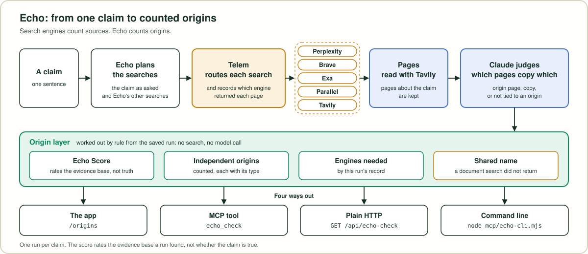

# Echo

## Judges: start here

Echo finds the source that is not in the results. It takes one claim, traces the pages that repeat it back to their
independent origins, and reads what those pages keep naming: on six of the sixteen Nov 14 claims the pages name a source
that no page of the run comes from. Search engines count sources. Echo counts origins.

The repo is public: <https://github.com/lucasmasen/echo>. The app is not deployed. It runs on your machine.

**Provenance.** The app and its original demo flows were developed before Nov 14. The `/origins` showcase uses sixteen Telem captures from Nov 14; it is a current-day view of work built over several days. Earlier captures from Nov 10–13 remain dated and accessible in the saved demo gallery and `public/demo-traces/`. Git history records when code was committed, not when every feature was written.



**The two-minute tour, with no API key.** Every step reads saved runs. None sends a search or a model call.

1. `npm ci`
2. `npm run dev`
3. Open <http://localhost:3000/origins>. First, above the tabs, the dark card "The source that is not in the
   results". Then eighteen tabs: sixteen claims traced live through Telem on Nov 14, a check of a pasted list of
   links, and last a run Echo got wrong, marked "Where Echo was wrong".
4. Open <http://localhost:3000/pitch> for the slides (arrow keys to move, `f` for full screen).
5. `curl "http://localhost:3000/api/echo-check?claim=Goldfish%20have%20a%203-second%20memory"` is the free endpoint.
6. `node mcp/echo-cli.mjs "It takes 21 days to form a habit"` is the command line (`--list` prints every saved claim).

**Three things to look at, in this order.**

1. **The source that is not in the results.** Open the brain tab. All 3 origin publishers name William James, and no
   page of the run is from him. The dark card above the tabs has the other five names: Maxwell Maltz, the Food and
   Nutrition Board, Malcolm Gladwell, Albert Mehrabian and Robin Dunbar.
2. **Where Echo was wrong.** The last tab. Echo scored a claim 98 from 8 origins, and most of them were write-ups of
   one MIT report. Echo flags the shared name, sends one more search through Telem, finds a copy of the report and
   folds 6 of the 8. The score goes from 98 to 67. That is still too high, and the page says so.
3. **What a search router could take back.** For the phone claim any one engine was enough. For body heat it took
   three. That is by each run's record, and it is on every Telem tab.

**Many pages, few independent origins.** On the phone claim Echo kept 19 pages. 6 of them lead back to one press
release, the other 13 Echo could not place, and the Echo Score is 18.

**The source that is not in the results.** A tool that removes duplicates or checks facts can only look at the pages
it was handed. Echo also reads what those pages keep pointing at. On six of the sixteen claims the pages name a source that no page of the run comes from:
William James on the brain claim (named on 6 of the 20 sites Echo kept, and by 3 of the 3 origin publishers), Maxwell
Maltz on the 21-day habit (11 of 19 sites, 3 of 4 origin publishers), the Food and Nutrition Board on 8 glasses of
water (6 of 20 sites), Malcolm Gladwell on 10,000 hours (16 of 20 sites, 4 of 5 origin publishers), Albert Mehrabian
on the 93% nonverbal claim (9 of 20 sites) and Robin Dunbar on 150 friendships (7 of 19 sites). It is found by matching names across the saved
passages, by rule, with no model call (`pageNames` in `src/lib/echo/upstream.ts`). It is a lead to go and look, not a
finding: a name many pages share can be a person or a body the claim is about. When at least half of the origins share
the name, the origin count may be too high, and Echo can go looking for the document through Telem (see "Where it was
wrong on Nov 14").

**How Echo uses Telem.** Telem routed every search of the sixteen Nov 14 runs, choosing among Perplexity, Brave, Exa,
Parallel and Tavily, and its reply says which engine returned each page (`src/lib/echo/telem.ts`). Echo saves that
record and adds three things on top (`src/lib/echo/origin-flow.ts`): the origins each engine's pages lead back to, the
fewest engines that reach every origin by this run's record, and the engines that answered each search. That is a
signal a search router could take back: how many engines each claim needed. By each run's record, 5 of the sixteen
claims needed one engine, 3 needed two, 7 needed three and 1 needed all five. Echo re-ranks results by independence, not relevance: origins first, confirmed copies folded under them, pages it could not place set aside.
Across the sixteen runs: 80 searches, 320 engine runs billed, about $1.99 of search at list price (Echo's own pricing
of each engine run), 285 pages kept, 67 independent origins counted, 32 of them with evidence of their own, 31 with
only one engine on record. An engine is
credited with a page only for the search that first returned it. One Telem run per claim.

| Claim (one run each, Nov 14) | Echo Score | Pages kept | Origins | Engines needed |
| --- | ---: | ---: | ---: | --- |
| Americans check their phones 96 times a day | 18 | 19 | 1 | 1 of 5 |
| You lose most of your body heat through your head | 86 | 18 | 7 | 3 of 5 |
| Humans use only 10% of their brains | 10 | 20 | 3 | 2 of 4 |
| Goldfish have a 3-second memory | 6 | 18 | 2 | 1 of 5 |
| 90% of startups fail | 52 | 19 | 4 | 3 of 5 |
| It costs 5 times more to acquire a new customer than to keep an existing one | 50 | 18 | 2 | 1 of 5 |
| It takes 21 days to form a habit | 72 | 19 | 4 | 2 of 5 |
| The average human attention span is 8 seconds | 81 | 14 | 5 | 3 of 5 |
| Only 1% of venture-backed startups become unicorns | 50 | 12 | 3 | 3 of 4 |
| A ChatGPT query uses 10 times more electricity than a Google search | 90 | 17 | 4 | 3 of 5 |
| The average person spends 2.5 hours a day on social media | 55 | 12 | 4 | 2 of 5 |
| You need to drink 8 glasses of water a day | 49 | 20 | 5 | 1 of 5 |
| It takes 10,000 hours to master a skill | 81 | 20 | 5 | 3 of 5 |
| 93% of communication is nonverbal | 70 | 20 | 6 | 5 of 5 |
| Humans can only maintain 150 friendships | 89 | 20 | 7 | 3 of 5 |
| People swallow 8 spiders a year in their sleep | 49 | 19 | 5 | 1 of 5 |

The Echo Score rates the evidence base one run found, not whether the claim is true. A debunked claim can score high:
body heat scores 86 and Echo's own answer for that run calls the claim a myth. "Engines needed" is by each run's
record, out of the engines whose pages Echo kept.

**Where it was wrong on Nov 14.** One more run from Nov 14, "95% of generative AI pilots fail", scored 98 with 8 origins
counted from 19 pages. Reading the judge's saved notes, most of them are separate write-ups of one MIT report, and
that report was not among the pages Echo kept. The run is in `evaluation/known-limits/`, out of every figure above,
and it is the last tab on `/origins`, marked as wrong. Two things were built after it:

- A rule (`src/lib/echo/upstream.ts`, no model call) flags it: 6 of the 7 publishers among its origins mention "MIT"
  in the passage Echo saved, and no page of the run comes from that source. The rule fires when at least half of the
  origin publishers name it.
- Echo then went looking (`src/lib/echo/upstream-fold.ts`, `npm run origin:upstream`): one more search through Telem
  found a copy of the report, hosted at mlq.ai and not on MIT's own site. A model judged which origins rest on it. 6
  of the 8 fold into it, so origins go from 8 to 3 and the score from 98 to 67. That is still too high: the two
  origins left standing are pages that mention neither the report nor the 95% figure. One measurement, saved once.

The same rule flags three of the sixteen runs: the brain claim (William James, 3 of 3 origin publishers), the habit
claim (Maxwell Maltz, 3 of 4) and the hours claim (Malcolm Gladwell, 4 of 5). On the brain and habit runs the look-up
found no page that is the document and folded nothing. No look-up is saved for the hours run.

**Supporting detail.** Asked the same question with one page per origin instead of every page Echo kept, Claude took
51% to 90% fewer input tokens across the sixteen runs. One measurement per run, and the origins-only prompt also tells
the model what Echo found, so it is not a blind test. Older saved runs have separate AI-made label checks in the historical evaluation files; the Nov 14 cohort has no label sheet.

**Honest limits.** One Telem run per claim, so nothing here ranks the engines. The same claim can score differently on
another day: goldfish scored 72 in an older saved run and 6 in the Nov 14 cohort; both captures retain their dates. It can differ on the same
day too: two re-runs saved in `evaluation/reruns/` (not on the page) scored phones 23 against 18 and habit 83 against
72. A model (Claude) judges
which pages copy which, so each link is a judgment, not a measurement. 193 of the 285 pages could not be tied to any
origin, and Echo says so. This setup runs on the local machine; the app is not deployed.
Without keys you see saved runs only: a new claim needs your own keys and spends on search and Claude.
How the repo maps to the judging criteria: [docs/JUDGES.md](docs/JUDGES.md).

---

Echo traces a claim through the pages that repeat it, groups pages making the same assertion, judges likely source relationships, and synthesizes an answer from root pages only. Each result can be copied or downloaded as a text report with the query audit, review prompts, source URLs, proposed relationships, evidence notes, and an explicit answer citation key with saved passages (**More → Copy report** or **Download report**; **Print report**, or the browser's own print, gives a one-page summary with the verdict, plain-search line, origins, copies with what Echo saw on each link, the answer, the caveats and the trace date; the result toolbar keeps **Present**, **Copy link** and **New trace** on its first row). It can also be saved as a portable `.echo.json` snapshot and reopened offline in another browser.

## What's new on Nov 13

Each item is described in detail further down. Figures are from single live runs or from offline replays, as marked.

- **Check these sources.** The **Check an AI answer's links →** button on the home screen opens a panel: paste an AI
  answer with its links (up to 20) and the sentence to check, and Echo reads only those pages, with no web search. Each
  link keeps the answer's citation number and gets a verdict ("independent origin", "published together with [1]",
  "copy of [2]", "possible copy", "could not be read"), then one plain line, for example "Your answer's 5 citations
  trace back to 1 independent origin, with its own evidence." A **Cite once** line says which links to cite and which
  repeat them, and **Show as data** gives the same result as a small JSON. **Try an example** fills a labelled sample
  answer citing five links about one phone-use statistic. One live run of that example on Nov 13 took 14–16 s and cost
  about $0.04 (list-price estimate). A citation identifies a supplied source; it is not proof of the claim, and origins
  are counted among the supplied links only.
- **How Echo checked this.** Under each result's timeline, one strip shows what the run did at each step (plan, search,
  read, group, judge, verify, answer), counted from the saved trace, with no model call.
- **Live search plan.** While a trace runs, the wait card names the claim, lists the search variants Echo built from it
  (ticked as each search finishes) and the sites found so far. Searches finish in seconds; most of the wait is Claude
  judging which page copied which.
- **Co-published releases counted once.** A newsroom release and its same-day wire copy (same text, within days) count as
  one independent origin. The tree tags the first page ORIGIN and the other SAME RELEASE (a bracket joins them when they sit in one
  column).
- **Unsure-origin guard.** A page Claude calls an origin but rates 50 or below out of 100, with no data of its own, is
  shown as unclear instead. Replaying today's post-judge rules (this guard plus the cited-undated-page, index-record and
  same-day wire-copy rules) over 19 saved runs of 7 claims, offline, lowers wrong calls from 28 to 8 and raises unclear
  pages from 59 to 76 (`npm run eval:all -- --replay`). This is an offline estimate on saved judgments, not new runs, and
  the labels it scores against were made by Claude (AI) from full pages, not checked by a human.
- **One vocabulary.** The count is "independent origins" on every screen; origins whose passages show data of their own
  are "with own evidence"; "root pages" is a page count (pages published together are several root pages but one
  origin). Percentages on tree links are Claude's own confidence estimate, not a measured accuracy.

## Origin layer (Nov 14, opt-in)

Echo finds the source that is not in the results. This layer counts and scores the independent origins of a finished
trace, draws where every page leads, and flags a name the pages keep pointing at when no page comes from it. It sits
on top of a finished trace and is **off by default** on the result page. To switch it on, click **Origin layer: off**
in the result toolbar (it then reads **Origin layer: on**), or press **Shift+O**. The choice is kept in this browser.
A build with `NEXT_PUBLIC_ECHO_ORIGIN_LAYER=1` starts with it on. No link or address can switch it on. With it off the
result page is exactly as before. The same graphic, always on, shows the saved runs at **`/origins`** (a static page:
opening it sends no search or model request). Everything except the token comparison is computed in the browser from
the trace: no request, no cost.

How it fits with Telem, in one line: **Telem tells you which engines answered. Echo tells you whether they told you
anything new.** Echo re-ranks results by independence, not relevance: origins first, confirmed copies folded under them, pages it could not place set aside.

### What `/origins` shows

Above the tabs, the dark card **The source that is not in the results** (`src/app/origins/upstream-map.tsx`). On six of the sixteen claims the pages name a source that no page of the run comes from:
William James on the brain claim (named on 6 of the 20 sites Echo kept, and by 3 of the 3 origin publishers), Maxwell
Maltz on the 21-day habit (11 of 19 sites, 3 of 4 origin publishers), the Food and Nutrition Board on 8 glasses of
water (6 of 20 sites), Malcolm Gladwell on 10,000 hours (16 of 20 sites, 4 of 5 origin publishers), Albert Mehrabian
on the 93% nonverbal claim (9 of 20 sites) and Robin Dunbar on 150 friendships (7 of 19 sites). A rule
over the saved passages, with no model call. A tool that removes duplicates or checks facts can only look at the pages
it was handed. Echo also reads what those pages keep pointing at. The card calls it a lead to go and look, not a
finding.

Eighteen tabs. Sixteen are claims traced live through Telem on Nov 14 (`mcp/traces/telem-*.echo.json`). One is "Check
a list of links": no AI answer produced those links, they were pasted in by hand, and Echo read them with no search.
The last, "Where Echo was wrong", is the run described under "Judges: start here". The number on a tab is that run's
Echo Score. As measured over the sixteen, one Telem run per claim: 80 searches, 320 engine runs billed (about $1.99
of search at list price, which is Echo's own pricing), 285 pages kept, 67 independent origins counted, 32 with
evidence of their own, 31 with only one engine on record.

Each tab, top to bottom:

- **Echo's answer**, written from the origins only, or a note when the origins are too thin to answer from.
- **Before and after.** The pages Echo kept as a flat list, then the same pages as independent origins.
- **Echo Score (0–100)** with **How this score was built**. `100 × (1 − e^(−W / 1.5))`, where W adds one weight per
  independent publisher among the origins: primary document 1.0, original reporting 0.8, official statement 0.6,
  press release 0.3, anonymous source 0.3, social post 0.2. Two rules keep it honest: an origin whose saved passage
  shows **no evidence of its own** counts 0.05 whatever its type, and **one publisher counts once**, as its earliest
  origin. Labels: 0–30 "Thin evidence base", 31–60 "Moderate evidence base", 61–100 "Strong evidence base". It rates
  the **evidence base one run found** (independent origins with evidence of their own, whichever way they point),
  **not whether the claim is true**. Body heat scores 86 and Echo's answer for that run calls the claim a myth.
- **Where the results lead (the flow).** Engines on the left, every page Echo kept in the middle, the independent
  origins on the right. It draws itself. Green is an origin page, blue a confirmed copy, an amber outline a page not
  tied to an origin. A dashed line is a possible link Echo could not confirm, and it is never counted. A table of the
  same data sits under it.
- **A name the origins share.** A rule with no model call (`src/lib/echo/upstream.ts`). It flags a run when at least
  half of its origin publishers mention one outside name and no page of the run comes from that source: William James
  on the brain claim (3 of 3), Maxwell Maltz on the habit claim (3 of 4), Malcolm Gladwell on the hours claim (4 of
  5). When that happens the origin count may be
  too high.
- **Echo went looking.** For a flagged run, one more search through Telem for that document and one model call that
  decides which origins rest on it (`src/lib/echo/upstream-fold.ts`, saved in `src/app/origin-upstream-saved.json`).
  On the brain and habit runs it found no page and folded nothing. No look-up is saved for the hours run. On the limit run it folded 6 of 8 origins and the
  score went from 98 to 67, which is still too high.
- **What each engine added.** The run's search bill (searches, engine runs billed, list price) and "Engines this claim
  needed: N of M": the fewest engines whose pages together reach every origin, found by trying every set
  (`originFlow(...).needed`). It is by the run's record: an engine is credited with a page only for the search that
  first returned it. On the phone claim every one of the five engines reached the one origin (1 of 5). On body heat no
  single engine reached all 7 and it took 3 of the 5, by this run's record.
- **What each search added.** The claim as asked and Echo's other searches, sent together, each with the engines that
  answered it (`originFlow(...).searches`). On body heat the claim as asked reached 3 of the 7 origins and Echo's
  other searches reached the other 4.
- **How the claim travelled.** For each origin with a confirmed copy, its own sentence stating the claim, then the
  sentence on each page confirmed as copying it, with the share of the wording it keeps.
- **Same question, two contexts.** Claude answers the claim once with every page Echo kept and once with one page per
  origin. Input tokens are the model's own counts, measured once per run: from 51% fewer (body heat, 8,133 to 4,003)
  to 90% fewer (phones, 9,304 to 971) across the sixteen. The origins-only prompt also tells the model what Echo
  found, so it is not a blind test. Saved in `src/app/origin-layer-saved.json`.
- **The record a search router could take back.** The run's per-engine findings as JSON. It is sent nowhere.

Below the tabs:

- **Engine scorecard.** One dot per origin, numbered with how many engines reached it, and the engines needed for each
  claim (`engineScorecard` in `src/lib/echo/origin-flow.ts`). One Telem run per claim. It shows the measurement and does not
  rank engines.
- **Nov 14 Telem runs**, one row per claim, with a CSV download and a JSON copy. Older saved runs and AI-made label checks remain in the historical demo and evaluation files; they are excluded from this cohort.
- **A limit Echo hit on Nov 14.** The 95% run, the flag and the look-up, as under "Judges: start here".
- **One check, six kinds of work.** Where the same check might apply, each shown with a saved run. Who might pay is a
  guess. Nobody has been asked yet.
- **Five ways into Echo**: the app, the links check, and three ways to call the check (the `echo_check` MCP tool, a
  GET address and a command line). A tool definition for function-calling frameworks is in
  `mcp/echo-check.tool.json`.

### Details

- **Origin types** are read by rule from each origin page's address, title and saved passage (a wire service, a
  `/press-releases/` path, "press release" in the title or a wire dateline at the top of the text is a press release;
  PubMed, a journal or a filing is a primary document; a `.gov` site is an official statement; an origin with evidence
  of its own is original reporting). An article that only mentions a press release is not one. No model call.
- **Counts are of the pages Echo kept**, not of every result the engines returned. On the phone run the searches
  returned 174 results and Echo kept 19 as about the claim: 2 origin pages that are one origin (Asurion's 2019
  release on its own site and on PR Newswire), 4 confirmed copies and 13 it could not tie to any origin.
- **Running the token comparison.** `npm run origin:compare` prints each context's size and sends nothing;
  `npm run origin:compare -- --spend` makes the two paid calls per trace (about 2–3 cents, through the daily cap). On
  any other trace the **Run the comparison** button asks the server (`POST /api/compare`), which answers only when
  `ECHO_ORIGIN_LAYER=1` is set in `.env.local`. A trace with no origin has nothing to compare, so no button is shown
  and the server refuses it.
- **`echo_check` for agents.** `mcp/echo-mcp.mjs` is a small MCP server (stdio, no extra dependency) with one tool,
  `echo_check(claim)`. A saved run answers offline and free. Any other claim is refused unless the server is started
  with `ECHO_MCP_LIVE=1`. The app is not deployed: it runs on your machine. Install lines, the GET
  address, the command line and the fields that come back are in the next section.

Offline checks, each free: `npm run check:origin-layer`, `npm run check:origin-flow`, `npm run check:upstream`,
`npm run check:origin-upstream`, `npm run check:origin-stability`, `npm run check:origin-batch` and
`npm run check:echo-api`. `check:links` counts `/api/compare` among the paid routes no link can reach. The layer went
through adversarial reviews on Nov 14, and the wording on screen follows their fixes.

## Call Echo from any agent

The same check, `echo_check(claim)`, can be called three ways. Each is one line, and each returns the same fields: the
Echo Score, the independent origins and their types, the page split in one sentence, Echo's own answer, and on a
Telem-routed run the engines that claim needed.

- **MCP** (Claude Code, Claude Desktop, any MCP client):

  ```bash
  claude mcp add --scope user echo -- node /absolute/path/to/echo/mcp/echo-mcp.mjs
  ```

- **HTTP** (anything that can make a GET; start the app first, and use its port):

  ```bash
  curl "http://localhost:3012/api/echo-check?claim=Americans%20check%20their%20phones%2096%20times%20a%20day"
  ```

- **Command line** (anything that can run a command):

  ```bash
  node mcp/echo-cli.mjs "Americans check their phones 96 times a day"
  ```

For a framework that takes JSON-Schema tools, the tool definition is in `mcp/echo-check.tool.json` (`name`,
`description`, `parameters`). Its description is the MCP tool's, word for word. Have the tool call the HTTP address or
the command line.

**What it costs.** Saved runs answer offline at no cost. Any other claim is refused by all three, with the list of
claims that do have a saved run. The one exception is the MCP tool with live mode switched on (`ECHO_MCP_LIVE=1`): it
then asks the app for a live run, and that spends (about $0.25 of search and Claude credit). The HTTP address and the
command line have no live mode.

**What comes back** (the phone claim, from the saved Telem run of Nov 14, trimmed):

```json
{
  "claim": "Americans check their phones 96 times a day",
  "echo_score": 18,
  "label": "Thin evidence base",
  "num_origins": 1,
  "pages": { "origin_pages": 2, "confirmed_copies": 4, "not_tied_to_an_origin": 13 },
  "engines_needed": { "needed": 1, "of": 5 },
  "source": "saved run",
  "captured": "2026-11-14T19:02:06.287Z",
  "routed_by": "telem"
}
```

- The score rates the evidence base behind a claim, not whether the claim is true. `engines_needed` is hindsight on
  one run, by that run's record. It does not rank search engines.
- `routed_by` says how the run got its pages: `telem`, `tavily` (every older run) or `links supplied`.
- `shared_names` is there only when at least half of a run's origins mention the same name in the passage Echo saved
  and no page of the run is that source. Each entry is `{ name, origins_naming_it, of_origin_publishers,
  origin_names }`, and `shared_names_note` says what it means. Those origins may share a source that is not among the
  pages, so `num_origins` is then an upper bound. It is found by rule, with no model call: a hint to check, not a
  finding. Say the origins "may share a source". Do not say one page is copied from another. On the Nov 14 saved runs
  the brain claim returns William James (all three origins) and the habit claim returns Maxwell Maltz (three of
  four). The command line prints it as a `Shared name` line.
- The matching rule is the MCP tool's: the same figures and the same key words, give or take one word one side leaves
  out. Then `wording_note` names the claim that was traced. A claim with a word swapped is refused. The newest saved
  run of a claim answers.
- HTTP: a claim with no saved run gets `404` with `{ error, hint }`, where `hint` lists the claims that have one. No
  claim gets `400`. Any site may read the address, and no reply is cached. It answers `GET` only.
- Command line: `--json` prints the same JSON, `--list` prints the claims that have a saved run, and a refused claim
  exits with code 1.
- One saved run checked links someone pasted in and searched nothing. It never answers a search question. Ask for it
  with `&links=1` on the address or `--links` on the command line.

The HTTP route and the command line read the saved run files (`public/demo-traces` and `mcp/traces`) and nothing else:
no key, no setting, no request. `npm run check:echo-api` checks that offline. It also holds both to the MCP tool's
answers and refusals, and to the newest saved run of every claim. The examples use a local address. On a deployed copy
the route needs those two folders shipped with it, and that has not been tested.

## Run locally

Requirements: Node.js 20.9 or newer.

```bash
npm install
cp .env.example .env.local
```

Add API keys to `.env.local`:

```dotenv
ANTHROPIC_API_KEY=your_claude_api_key
TAVILY_API_KEY=your_tavily_api_key
ANTHROPIC_MODEL=claude-sonnet-5-5
```

Optional: route the searches through [Telem](https://docs.telem.ai) (a web search router: one call searches several providers such as Exa, Tavily and Brave, and says which it chose). Add to `.env.local`:

```dotenv
TELEM_API_KEY=tlm_your_telem_key
# ECHO_SEARCH_ROUTER=tavily   # forces Tavily search even with a Telem key (e.g. when Telem's credit runs out)
```

With `TELEM_API_KEY` set, each query variant goes to Telem's `/v1/search` with auto-routing on, choosing among Exa, Tavily, Brave, Parallel and Perplexity; page reading stays on Tavily, so `TAVILY_API_KEY` is still required. Without it, or with `ECHO_SEARCH_ROUTER=tavily`, search is Tavily as before. Telem bills each provider that answers at its own price from prepaid credit: Echo reserves $0.031 per basic search and $0.040 per deeper search on its $2 daily cap (every allowed provider at list price, Exa estimated at $0.015 for 10 results), settles at what the providers that answered cost, and shows it on the receipt as "search $X via Telem". The live wait tags each searched variant with its providers ("Exa · Brave"; three names at most, then "+N"), "How Echo checked this" says "N searches routed by Telem across …", and the search audit lists the providers per query. The claim box's status line names the router ("Provider keys configured · Search: Telem" or "Search: Tavily") and the cap line reads "Echo API (Claude + Telem + Tavily)" when Telem searches; a Telem key that is missing (with `ECHO_SEARCH_ROUTER=telem`) or does not start with `tlm_` shows a warning there instead ("Search is set to Telem, but its key is missing or is not a Telem key …"). `GET /api/analyze` reports this as `searchRouter` (`"telem"`, `"tavily"` or `"misconfigured"`, a name only). A 401, 402 (credit used up) or 429 from Telem stops the run with a plain message and is never retried.

**Deep search** (opt-in, one run at a time): the **Standard | Deep** toggle beside **Trace sources** in the claim box. Standard (the default) is the run described here. Deep (`src/lib/echo/search-mode.ts`) builds 12 query variants instead of 10, asks each search for 20 results (Tavily's `max_results`; with Telem, 20 per engine), stops the basic pass only at 100 distinct pages, always runs the deeper pass on the first 4 variants (so at most **16 searches**, whichever router: with Telem the breadth comes from more results per search, not more searches), reads up to **50 pages** (at most 3 from one site) in 5 extract batches, groups them with a 4,000-token output limit, and judges them in requests of at most 20 pages, 3 at a time; a claim group larger than that is split by date and each part sees up to 20 of the group's other pages (the ones it cites or shares wording with, and the earliest) as possible parents. Every post-judge guard runs once over all the pages. The toggle's tooltip gives the estimate from `npm run measure:cost` (not a measured run): **≈$0.6–1.1 with Telem** (up to $0.69 of it Telem credit when every engine answers every search), **≈$0.4–0.6 with Tavily**, **~1–2 minutes** (Standard ≈$0.2, under a minute). The trace records `searchMode: "deep"` (absent on Standard runs and every older trace); the wait card and the result tag say DEEP SEARCH; the run's receipt has every request. The toggle goes back to Standard after a Deep run finishes; no link or URL parameter can set it (the request body's `searchMode: "deep"` is the only way, and `npm run trace:claim -- "claim" --deep` from the terminal). A Deep run needs room under Telem's cap for its 16 searches ($0.69), or it searches with Tavily.

Then start the app:

```bash
npm run dev
```

Open [http://localhost:3000](http://localhost:3000). The Ghost and Zombie slots open real captured live traces (see Saved live demo traces below), falling back to clearly labeled synthetic rehearsal snapshots only if those files cannot load. Their banners, edge labels, and confidence displays say they are samples; their pages and edges are not live research results. Enter a claim and choose **Trace sources** to run the Tavily + Claude pipeline. Backup chips fill the input for a manual live check; they are not marked as tested.

See [DEMO_PRETEST.md](./DEMO_PRETEST.md) for the current claim candidates, pre-test coverage, backup pool, and rehearsal checklist. The chosen claims are still candidates: repeat their live traces with the current build before using their trees as stage evidence.

`npm run scout:claim -- --claim "Full claim" --urls urls.txt` is a free way to choose claims before spending credits: it fetches up to 40 listed pages directly (no Tavily or Claude calls), reads usable dates, selects the same claim-focused passage a live trace would, and lists dated pairs whose passages share distinctive wording or substantial word-for-word overlap (wording that merely restates the claim is ignored). It prints a rough copy-potential rating. On the 20 pages from a live 10%-brain trace it rated copy potential LOW, matching that trace's 0% echo. These are heuristics for choosing claims, not source judgments.

`npm run pretest:claim -- --claim "Full claim" --phrase '"quoted phrase"'` checks one candidate with two Tavily searches and reports URL/date coverage plus snippets. It separates dates usable for direction (page text, URL path, or publisher metadata read directly from each page at no provider cost) from search-provider estimates, and prints a date check against the claim-freeze gate. It does not call Anthropic, but it may use Tavily search credits; Echo does not run it automatically.

`npm run check:pipeline` runs an end-to-end source trace with mocked provider responses and a temporary budget ledger. It checks off-claim filtering, the tree, citations, and token-count configuration without using any Tavily or Anthropic credits.

`npm run check:graph` checks source-spread traversal, including exclusion of uncertain links and protection against cycles, without any provider calls.

`npm run check:portable` checks that manual inspection marks survive a trace export and malformed marks are rejected, without any provider calls.

`npm run audit:trace -- path/to/trace.echo.json` reads one saved trace locally and prints coverage, date provenance, candidate roots, likely and possible links, failed searches, answer-source limits, and counts of source and answer reviews. It flags statements manually marked unsupported and source judgments challenged by a reviewer without changing the stored verdict. For generated answers it also checks, with no model call, whether every number a statement states (digits, comma thousands, decimals, and percentages written as `%`, `percent`, or a spelled-out tens word) appears in at least one passage that statement cites, and lists any that do not. A matching number does not prove the statement; a missing one is a prompt to open the cited page. Add `--json` for machine-readable output. It makes no search or model calls and cannot certify that a claim or source relationship is true. `npm run check:readiness` checks the audit command with a synthetic trace in CI.

`npm run eval:trace -- init path/to/trace.echo.json path/to/labels.json` creates a human-review sheet with blank expected classifications and any saved page notes copied in; fill source classifications and parent keys only after opening the pages. `npm run eval:trace -- score path/to/trace.echo.json path/to/labels.json` reports classification agreement, derived precision/recall, exact parent links, abstentions, and missing labeled sources. Both commands are offline. See [EVALUATION_GUIDE.md](./EVALUATION_GUIDE.md) for the labeling rules and score limits. `npm run rejudge:trace -- trace.echo.json labels.json --mode both` re-runs only the source-judgment step on a saved trace (one Claude call per run, about $0.04, counted in the $2 daily cap; no search credits); add `--links` to first add the source-link citations a live run would now find in each page's HTML and scores the current judge against the retelling check side by side. Echo also reads each retrieved page's own HTML links (free, direct fetch; `ECHO_HTML_LINKS=0` turns it off), because search text often drops a page's source list. `npm run eval:all` scores every saved trace that has a label sheet (bundled and `evaluation/runs/`) in one offline table. `npm run trace:claim -- "claim" [out.echo.json] [--labels labels.json]` runs one live trace from the terminal through the same pipeline and daily-cap ledger as the app (unlike `pretest:claim`), saves it, and prints time, spend and, with labels, the score. `npm run check:evaluation` verifies the commands with a synthetic fixture; it is not a model-quality benchmark.

The app includes a collapsible plain-language glossary, offline-readiness panel, per-trace coverage panel, and live search-query audit. Coverage shows date availability, extracted-passage availability, distinct domains, unresolved links, and root pages with own evidence without reducing them to a misleading confidence score. Each saved passage is limited to 2,000 claim-focused characters; even a successful extraction is not the full original page. Inside coverage, **Pages to inspect** lists sources with unresolved links, snippet-only extraction, uncertain root evidence, low-confidence relationships, links without a visible URL to the proposed parent, or missing and estimated dates; selecting a row opens its source detail. The same review flags appear in copied and downloaded text reports. The query audit lists each basic or deep-search variant, its request status, raw result count, claim-relevant hits, and newly discovered pages; selecting a page jumps to its source detail. It also records variants skipped after enough pages were found. These panels add no provider calls. The offline panel (hidden from visitors of a presenter-locked copy while online; always shown offline) lists which pinned live traces are saved in this browser and whether a production app shell is cached; the header reflects the browser's online/offline signal, and result tags distinguish rehearsal fixtures from cached and fresh live analyses. The production build also includes a web app manifest for adding Echo to a phone's home screen.

A short trace-quality strip under each live verdict says, in plain words, how many confirmed copies (dated or cited) and how many possible copies whose link is not confirmed it found; possible copies stay out of the echo rate. It also says how many pages have no reliable date (none, or only a search estimate); with the dated span beside it, the two add up to every page. The copied report and presentation include the same caveat, so a thin chronology cannot silently appear as a clean result.

When no candidate root has confirmed primary evidence in its retrieved passage, Echo uses a deterministic, source-limited answer with root citations instead of paying for another Claude synthesis call. It says the claim could not be verified **from those passages** and directs the reviewer to the full sources. This result is separately labeled in the interface and portable trace.

Custom live claims are saved as up to five recent traces in this browser. Reentering the same claim opens its saved result with no search or model call; the input button shows **Open saved trace** when that will happen. The **Recent live traces** panel lets you reopen, rerun fresh, or remove each saved result. Fresh custom runs replace the earlier saved result, but the prior one stays in memory for immediate comparison while the new result is open. Save either run as a trace file if you want a durable version. An imported live trace can be kept in this browser with **More → Keep in browser**; complete preset traces enter the pinned cache, and custom traces enter Recent live traces. The option is shown only when the browser will keep the trace: a demo claim's trace that leaves a page unclear from a search snippet alone (every bundled trace does) and a Check these sources trace are not kept, so they do not offer it. Importing alone does not modify either cache. This browser history is separate from portable trace files and from the pinned demo cache.

The server also reuses complete custom analyses for 15 minutes in the same process, up to 100 entries, so repeated requests from another tab can avoid provider calls. If a run fails after extraction, a retry can reuse successful source extracts for the same claim and URL for 15 minutes, avoiding duplicate Tavily extraction calls. **Run fresh** bypasses both caches and fetches new source text. These in-memory caches are per server instance; the browser's saved traces are what survive restarts and offline use.

The source detail shows **Downstream spread** for the selected page, with direct and transitive pages linked below it. You can open those pages from the panel. It counts only links judged derived, excluding uncertain links and pages outside this trace; it is not an audience or traffic measure.

For a page with a proposed parent, source detail now summarizes three clues visible in the saved passages: whether the parent URL appears, whether a distinctive five-word-or-longer phrase appears in both excerpts, and what share of the page's six-word sequences also appear in the parent's passage (word-for-word overlap, which makes reposted or syndicated text stand out). The review queue flags a derived link when neither clue is visible. These are prompts to inspect the originals; a paraphrase can be genuinely dependent without either clue, and a shared phrase can have an innocent explanation. The copied report records clue counts without treating them as proof.

For live pages, **Mark page inspected** records which source pages you have manually reviewed. You can assess whether the original page supports or challenges Echo's relationship judgment, or say you cannot tell. A short review note can record the date, citation, or evidence gap behind that assessment. **Next flagged source** in source detail moves to the next uninspected page without reopening coverage. Marks, assessments, and notes appear in the copied report and portable trace; challenged judgments rise to the top of the review queue and are marked in the tree and timeline. The tree's **Challenged** focus finds them directly. They never change Echo's automated tree or verdict. Imported review data remains labeled as information saved in that trace, rather than proof that the current viewer inspected the source.

The collapsible **Root evidence ledger** puts each candidate root's date, primary-evidence status, and downstream count in one list. Selecting a row opens that source in the tree. Rehearsal roots are labeled as illustrative rather than assessed evidence.

Choose **Present** on any result for a judge-facing walkthrough: claim and verdict, the evidence funnel ("How Echo searched", or "What Echo read" for supplied links), interactive source tree, how it spread (when two or more pages have a reliable date), root-by-root evidence, cited takeaway, and how we checked (on a run with an accuracy check). The demo slots and backups have seven slides; the saved Check these sources run has six. Switch between **Family tree** and **Timeline** to inspect relationships or publication order. In the tree, focus **Roots**, **Echoes**, or **Unclear** to highlight that relationship type while keeping the full graph visible; the source finder narrows the highlight by title, domain, or retrieved passage, brings the first match into view, opens it with Enter, and highlights the searched phrase in source detail. Select a page and choose **This path** to highlight its connected trail back to the best-supported source. For a derived page, expand **Compare the linked pages** to read the linked source and selected page side by side, with their date, extraction method, and shared word sequences highlighted in the retrieved passages. Word order must match; punctuation and spacing are normalized. Phrase matches are review clues, not proof of copying; synthetic rehearsal text is excluded from the comparison. Use the arrow or Page Up/Page Down keys to move through the presentation, **Esc** to exit, and **Full screen** for a projector view. These interactions use the result already on screen and make no search or model calls; rehearsal and imported snapshots stay clearly labeled.

Use **More → Save trace file** on any result to export a complete, portable snapshot. **More → Open trace file** (or **Open a saved trace file** before any result is open) loads one without making provider calls. Imported analyses are labeled as snapshots and are not silently added to the browser's live cache. Echo validates the file structure and cross-checks clusters, roots, links, and summary counts; files are limited to 2 MB and 200 pages. HTTP and HTTPS source links are accepted.

Use **More → Compare runs** on a result to load another saved `.echo.json` trace for the same claim. Echo compares page URLs, root counts, verifiable roots, echo rates, answer text and status, and cited root pages offline. For pages present in both runs, it also flags changes in source classification, proposed parent, publication date and its source, extraction method, saved passage, primary-evidence status, and root candidacy. Whitespace-only passage differences are ignored. Collapsible sections show changes in manual answer checks, source inspection marks, source assessments and notes, and search-query coverage. Answer checks are matched by statement text and cited page URL; source reviews are matched by normalized URL, so regenerated page IDs do not appear as changes. A fresh rerun with a browser-saved result opens the comparison automatically and offers **More → Compare prior run** until you leave that result. The comparison can be copied as text. It keeps synthetic rehearsal graphs separate from live traces and explains that search coverage or source judgments can change between runs. It uses saved data already on the device and makes no provider calls.

Echo caps its own spending **per provider, per Pacific calendar day** (since 2026-11-13; it used to be one combined $2 cap):

| Provider | Default cap | Variable (in `.env.local`) | Held to at most |
| --- | --- | --- | --- |
| Claude (grouping, judgment, answer) | $50 a day: a runaway ceiling so a bug cannot loop, not a practical limit | `ECHO_CLAUDE_DAILY_CAP_USD` | $200 |
| Tavily (searches and page reading; only page reading when Telem searches) | $5 a day | `ECHO_TAVILY_DAILY_CAP_USD` | $50 |
| Telem (searches it routes; prepaid credit) | $3 a day | `ECHO_TELEM_DAILY_CAP_USD` | $20 |

Telem's spend is also kept as a running total over every day, shown against `ECHO_TELEM_CREDIT_USD` (default $20, the prepaid credit; advisory, never a block: Telem's console has the real balance, and Telem itself refuses a search when the credit is gone). The claim box's budget line reads, for example, "Telem today $0.42 / $3.00 · total $1.10 of $20 credit · Claude $0.31 / $50.00 · Tavily $0.08 / $5.00 · local ledger · resets midnight Pacific" (with Tavily searching: "Claude today … · Tavily …"). When Telem's own cap is reached, or what is left of it cannot cover a run's typical searches (10 × $0.031), the run **searches with Tavily instead of failing** and says so on the wait card ("Telem's daily cap reached, this run searched with Tavily"); a Telem search refused mid-run switches the rest of that run to Tavily the same way, and the trace records `searchFallback: "telem-daily-cap"`. Claude's or Tavily's cap reached stops a run with "Daily spending cap reached", naming that cap. The old `ECHO_ANTHROPIC_DAILY_CAP_USD` and the per-command `ECHO_DAILY_CAP_OVERRIDE_USD` are no longer read (remove them from `.env.local`; they change nothing). An older ledger file still loads: its days, whose split is unknown, count against Claude's ceiling, and Tavily's and Telem's caps and the Telem total count from the first run after the upgrade (set `ECHO_TELEM_CREDIT_USD` to the credit left in Telem's console then, so the total reads true).

Each Tavily request reserves its credit cost before it is sent (1 credit per basic search, 2 per advanced search, 1 per 5 extracted pages at basic depth) and settles the credits actually returned; failed or cancelled requests release their reservation. Each Telem search reserves the most its allowed providers could cost ($0.031, or $0.040 at the extended tier) and settles at what the providers that answered cost. `ECHO_TAVILY_USD_PER_CREDIT` sets the price per credit (default $0.008, pay-as-you-go; set 0 to stop counting Tavily, for example on a free plan). Before starting a search, Echo checks that Claude's cap has room to reserve the classifier's maximum output and Tavily's has room for a typical run's credits; this avoids spending search credits on a run that cannot reach source judgment. Before each paid Claude request, Echo uses Anthropic's free token-count endpoint with the same structured output schema as the paid request, then reserves the estimated input cost plus the request's maximum output cost; successful responses reconcile that reservation against reported token usage. Without shared storage, the ledger persists in the ignored `.echo/anthropic-daily-budget.json` file on this machine, with a file lock to coordinate multiple local app processes. If both Upstash Redis REST environment variables are present, Echo instead uses atomic Redis scripts to reserve and settle costs across app instances. The budget line in the UI identifies which ledger is active. Use the same Upstash credentials locally and on Vercel if those instances must share one set of daily caps; otherwise their ledgers are separate (in Redis, each provider has its own key per day, and Telem's running total one more key). A partially configured or unreachable Redis store pauses live Claude calls. On Vercel, live calls remain disabled until that shared store is configured; serverless instances cannot share the local file ledger. This guard does not cap Anthropic usage from other apps or machines. Anthropic Console currently provides monthly, not daily, spend limits, so set an organization or workspace limit there for an account-wide backstop.

The supported lower-cost model is `claude-haiku-5-5`. To use it for all Claude stages, change `ANTHROPIC_MODEL` in `.env.local` and restart `npm run dev`; Echo's budget guard uses Haiku's separate token rates, including its higher price tier for prompts over 100,000 tokens. Current published rates for prompts under that threshold are $0.10/$0.50 per million input/output tokens for Haiku 5.5 versus $2/$10 for Sonnet 5.5. This lowers the price per token; it does not necessarily reduce token count. As a middle ground, set `ANTHROPIC_CLASSIFIER_MODEL=claude-haiku-5-5` and `ANTHROPIC_ANSWER_MODEL=claude-sonnet-5-5` to use Haiku for claim grouping and source judgments while keeping Sonnet for the final answer. Compare the same claims before freezing a stage demo because source-dependence quality has not yet been benchmarked here.

## Saved live demo traces

`public/demo-traces/` holds five real live runs saved with the app: slot 02 (captured 2026-11-10), slot 01 and the goldfish backup (2026-11-11), the head-heat backup (2026-11-12) and the saved Check these sources run (2026-11-13). Demo slots 01 and 02, the two backups and **Saved check: 5 links → 1 origin** open them directly, tagged "SAVED LIVE RUN · captured <date>", and the service worker caches them for offline use. The bundled run always opens, even after a live run of the same claim in this browser; that browser run is only a fallback when the bundled file cannot load (and it stays in Recent live traces). They can also be opened with **More → Open trace file** (no keys or credits needed):

- `americans-check-phones-96-times.echo.json`: 13 pages, 31% echo, 2 independent origins (live run captured 2026-11-10, replacing an earlier 11-page capture). The 2019 Asurion survey release (asurion.com and PR Newswire, same day, counted as one co-published origin) is copied by Fox 13 and KABC in 2021, a blog copies the Fox 13 article, and an undated reference page that cites "Asurion (2019)" is linked to the release by citation. Social posts and a rewritten stats roundup stay unclear. It also carries a saved copy hunt (run live 2026-11-10): 15 possible copies outside the trace that contain the release's exact wording (8 dated after it, 7 undated), shown offline without a new search. The answer notes that Asurion's own 2022 survey superseded the 96 figure.
- `humans-use-10-percent-of-brain.echo.json`: 20 pages, 15% echo, 8 independent origins (live run captured 2026-11-11, replacing an earlier 0%-echo capture). Medical News Today, Wikipedia and Johns Hopkins are linked to Scientific American's 2008 interview by citation. No answer is written: every root is an expert quote or explainer without inspectable data, so Echo reports that the origins cannot verify the claim (headline "No origin with its own evidence — this stat is a ghost."). It carries a saved copy hunt (2026-11-11): 15 possible copies quoting the interview's "the brain represents three percent of the…" line (6 dated after 2008); the interview's other two phrases were set aside as common wording.
- `check-these-sources-phones.echo.json`: a saved **Check these sources** run (captured 2026-11-13; a byte-for-byte copy of `scripts/fixtures/sources-phones-live-2026-11-13-v2.echo.json`): the example's 5 supplied phones links → 1 independent origin, with its own evidence (asurion.com, PR Newswire published together with it). **Saved check: 5 links → 1 origin** in the Check these sources panel and under MORE SAVED RUNS opens it (also `/?trace=check-these-sources-phones`), offline too; a failed or stalled live run of the same links offers it. It has no label sheet and is not scored.

Traces are snapshots of what search and the model returned at capture time; rerunning a claim can retrieve different pages.

`evaluation/americans-check-phones-96-times.labels.json` labels 14 pages (the 11 pages of the earlier capture plus 3 new pages in the current trace) using EVALUATION_GUIDE.md, with the full-page evidence for each label in its note. **These labels were made by Claude (AI) from pages fetched on 2026-11-10, not by a human**, so treat the score as an evidence-documented consistency check, not human verification. `npm run eval:trace -- score public/demo-traces/americans-check-phones-96-times.echo.json evaluation/americans-check-phones-96-times.labels.json` reports 13/13 kinds, 0 settled mistakes, 0 abstentions, exact parents 3/4 (Fox 13 is linked to asurion.com rather than the same-day PR Newswire copy of the same release); one labeled page (an Instagram post) was not retrieved in this run. The earlier capture scored 9/11 with 2 abstentions. Caveats: one claim and 13 pages; 6 of the 13 agreements are "unclear" matching "unclear"; KABC's parent is ambiguous (it names Asurion but may have come via the 2021 Fox rewrite).

`evaluation/humans-use-10-percent-of-brain.labels.json` labels 29 pages from two brain captures the same way (AI-made, from full pages fetched 2026-11-10 and 11; one label uses a Wayback Machine capture date, one a Wayback copy). The current brain trace scores 16/20, 0 settled mistakes, 4 abstentions, exact parents 3/5 (it misses UAMS → Washington faculty page and Psychology Today → Scientific American). The earlier capture, taken before citation detection existed, scored 14/20 with 1 settled mistake and found none of its labeled copies; two citation fixes found from those labels (spaced organization names and reference entries "(2008). <title>") and a "named as source" rule ("according to … in Scientific American", only for pages dated after the source) found the Wikipedia and Medical News Today links on the live re-run.

- `goldfish-3-second-memory.echo.json` (backup claim, live run 2026-11-11): 14 pages, 4 independent origins (a 1976 PubMed study, BBC's report of an Oxford study, Live Science, ScienceABC), 7% echo, with a written answer. Against `evaluation/goldfish-3-second-memory.labels.json` (AI-made): 12/14, 0 settled mistakes, 2 abstentions, its one copy with the exact parent. The "3-second goldfish memory" backup button opens it.
- `lose-most-body-heat-through-head.echo.json` (second backup, live run 2026-11-12 ~5:20pm PT, after the HTML source-link and date fixes): 18 pages, 4 independent origins, WebMD's 2011 interview dated from its own page, Badger and MeatEater linked to WebMD through their HTML links. Scored against AI-made labels: 10/15 kinds, 2 settled mistakes, 3 abstentions, exact parents 2/4. Two earlier live runs of this claim (11/11, 11/12 morning, before the fixes) scored 5/13 with 10 and 6 mistakes; the accuracy card lists them marked "earlier Echo".

## Copy hunt (beta, off by default)

Set `ECHO_COPY_HUNT=1` in `.env.local` to show **Hunt for more copies** under the root ledger of a live or saved trace. Echo takes the distinctive phrases that an original's confirmed copies reused from it (phrases that restate the claim are skipped), runs up to 3 exact-phrase basic Tavily searches (about $0.02, no Claude, counted in the daily cap), and lists pages not already in the trace that contain a phrase verbatim, either in the search title or snippet or in the page itself (Echo opens up to 30 new results directly, free, with the same public-address and size limits as the date fetcher), with a date read from the page and whether it is dated after the original. These are possible copies only: Echo has not read them in full, and they never change the tree, roots or echo percentage. The panel lists the five that match the most phrases first; **Show all** lists the rest. They are saved with the trace file. A trace with no confirmed copies has nothing to search for. `npm run check:copy-hunt` tests it offline. It has not yet been run live.

## Accuracy card

The two bundled demo traces show an **Accuracy check** card: their agreement with the labeled pages in `evaluation/`, including every disagreement. Scores are generated into `src/lib/echo/demo-scores.ts` by `npm run eval:demo-scores` (local, no provider calls); `npm run preflight` fails if they are stale. The card appears only when the open result is that exact bundled trace.

## Demo preflight

`npm run preflight` (add `-- --serve` after `npm run build`) checks that both demo traces import, still score at least as well as `evaluation/demo-baseline.json` against their labels, are in the offline cache list, and that every file offline mode needs loads from the production build. No provider calls. `npm run smoke:ui` then clicks through the demo in installed Google Chrome (both slots, both backups, the saved Check these sources run, Present mode, the saved-run fallback after a failed live run, and offline reload), against a production server started with blank API keys.

## Live analysis pipeline

1. Echo creates ten deterministic search variants without spending a Claude call.
2. Tavily runs basic searches (ten results each; Tavily bills per request by depth, not per result), with a small advanced-search pass when the first results are thin; Echo saves query-by-query status and deduplication counts in the trace.
3. Echo normalizes tracking parameters, query order, and trailing slashes to deduplicate URLs, then selects up to 20 pages, balancing the strongest search matches with distinct source domains. It extracts them in batches of up to 10 and finds URLs to other retrieved pages in each selected passage without another provider call.
3a. Echo then reads each selected page itself, once, with no provider credits (`ECHO_HTML_LINKS=0` turns this off): the publisher's date (meta tags, JSON-LD, US-style `01/04/2011` dates on English pages, journal issue months, dates up to 1 MB into the page), the page's links to other retrieved pages and its article text for citations (reference lists that search trimmed, DOIs, PubMed/PMC ids; menus, headers, footers, sidebars, comment threads, related-story lists and share bars skipped; links to a page's own site, to pages dated later, and to articles a site moved keep their meaning), and, when search extraction returned nothing, the page's own article paragraphs. Every redirect hop is checked and hosts resolving to private addresses are refused; tag scans are bounded so a malformed page cannot stall the server. Pages whose date is missing or only a search estimate get this pass first; the rest share a 7-second limit.
4. Claude groups pages by assertion and marks groups that only share keywords or numbers but address a different claim. Those off-claim hits stay counted in the search audit but are excluded from the tree and verdict; uncertain pages stay in. Claude then judges each retained page's likely parent, confidence, date, and primary-evidence status. The judge sees up to 1,200 characters of each page's claim-focused passage, plus deterministic wording clues: for each page, up to three other pages in its group that share a distinctive verbatim sequence of five or more words, excluding phrases that mostly restate the claim. Each clue also carries an overlap score: the share of the page's six-word sequences that appear in the other passage, so syndicated or copied text (wire stories, press-release reposts) stands out from independent reporting on the same topic. These clues are evidence for the model to weigh with chronology, not automatic links. The source detail lets you inspect any retrieved pages linked from that passage; a link can be navigation rather than a citation.
4a. Deterministic rules then check the judge: direction comes only from a strictly earlier trustworthy date or from a verified citation (a link, a distinctive title, or an organization with the year; a name alone never sets direction); a page that only retells an outside source without reporting or data of its own is shown as unclear, not an origin (`ECHO_RETELLING_CHECK=0` turns this off); an origin the judge itself rates 50 or below out of 100, on a page with no primary evidence, is also shown as unclear (on the labeled runs made with the current judge, all 6 such calls were wrong); when the judge picks a parent the page does not cite but the page cites exactly one earlier page in its group, that page is used; a PubMed-style index record of an article in the group is a copy of it; and roots that are the same release or the same publication (same text within days, or the same distinctive title) count as one origin. A page the judge left unclear that is the same text as an origin in its group, posted within three days and not after it (a wire copy of a newsroom release the same day), joins that origin as one co-published release, so the pair is counted once whichever way the judge answered.
5. Echo prioritizes root pages with directly inspectable evidence of their own (primary evidence) when selecting up to 12 pages for answer synthesis. Claude returns one to four short statements with root source numbers. Echo validates every number, attaches citations to each statement, and shows only cited roots in the answer card. The card and text report disclose roots omitted by the source limit and supplied roots not cited in a generated answer. Expand **Inspect cited passages** to read the saved text and open each original source. Expand **Review answer statements** to see, for each statement, whether every number it states appears in a cited passage (an automatic, no-cost check; a match is not proof), and to record whether each statement is supported, unsupported, or unclear after checking the originals; these manual checks stay in the trace and never change Echo's automated verdict. Invalid statement citations are replaced by a source-list fallback. Echo does not infer what derived pages added from root-only input; its note explains that repeats were excluded from independent support. A citation number establishes the page supplied to the model, not that the page proves the statement, so inspect the linked passage.

**Check these sources** (the bordered **Check an AI answer's links →** button at the right of the claim box's label; it opens the panel and runs nothing) skips steps 1–2: paste an AI answer with its links, or a list of links, plus the sentence to check, and Echo reads exactly those pages (up to 20 public http/https links, canonical and deduplicated; the same address rules as every other page read) and runs steps 3–5 on them unchanged. The result keeps the normal trace view under a headline such as "5 supplied links → 1 independent origin", says no web search ran, and names supplied links that returned no readable text (`sourceCheck.unreadUrls`; they are not judged) and pages that do not address the claim. That card is the result's one verdict: its tiles read "5 links read · 1 independent origin · 1 with own evidence", and the generic verdict banner with its echo rate is not shown for a sources result (the rate counts only confirmed copies, so it read "40% echo" when 4 of 5 links trace to another supplied link or are unclear; the text and printed reports leave it out too). The run's receipt reads "no web search · 1 extract credit". Under the per-link list a **Cite once** line regroups the same rows (no model call): "Cite once: [1] asurion.com (also published as [2]). Repeats it: [3], [5]. Unclear: [4]." It names each independent origin with the links published together with it, the links whose confirmed copies lead back to it, then unclear links (a possible copy is unclear), copies of an unclear link, unread links and links not about the claim; with no confirmed origin it says there is none to cite once. **Copy** copies that line; **Show as data** shows "The same result as data, for tools that use citations": a small JSON with the line, each origin (`cite`, `publishedTogether`, `repeatedBy`, `ownEvidence`) and each citation (`n`, `url`, `status`, `of`, `origin`). The text report ends its supplied-links section with the line too. `check:pipeline` tests it on both saved phones sources traces and edge cases; `check:copy` renders it for every origin/copy/unclear judging of their pages and fails on "drop", "wrong", "public API", an overclaim, a retired name, a miscounted origin or a number that is not a supplied citation. A citation identifies a supplied source, not proof of the claim. `/api/analyze` takes `urls` next to `claim`; a bad list gets a plain 400 (`SOURCES_INVALID`) before anything runs, and the presenter lock, JSON-only rule, claim checks and the $2 daily cap all apply. The trace carries `sourceCheck.urls` instead of a search audit and round-trips through trace files; the server cache key includes the links. A `?urls=…&claim=…` link only fills the panel; only its button starts a run. These runs are not kept in Recent live traces (which are found by claim alone); save a trace file to keep one. Tested offline by `check:pipeline`, `check:readiness`, `check:portable`, `check:links` and `smoke:ui`.

Citation numbers carry through. Each chip shows the number the pasted answer gave its link: `[1] https://…`, `1. https://…` or `2) Title https://…` at the start of a line, markdown footnotes (`[^1]: https://…`), numbered markdown links (`[1](https://…)`) and `(1) https://…`; an answer that numbers none is numbered 1..N in pasted order, links it leaves unnumbered (or a second page given a number already used) take the next numbers after the highest, an http, https or www. copy of a page is one link with the first number found and its https address, and a removed chip's number is not reused. Removing a chip applies to the current paste (pasting the link again after clearing the box brings it back) and the panel says how many were removed, with **Undo**; links over 2,000 characters and links past the 20th are reported as left out. Under the headline the result lists every supplied link in pasted order with what the trace found, then one plain line (Present slide 1 shows the same list and line, with the Cite once line under it), for example:

```
[1] asurion.com — independent origin, with its own evidence
[2] prnewswire.com — published together with [1], one origin
[3] fox13seattle.com — copy of [2]
[4] kabc.com — possible copy of [1], link not confirmed
[5] churchandculture.org — copy of [3]
Your answer's 5 citations trace back to 1 independent origin, with its own evidence.
Cite once: [1] asurion.com (also published as [2]). Repeats it: [3], [5]. Unclear: [4].
```

(These are the rows of the saved v2 run of these links.) Other rows read "unclear (same text, no earlier date)" and similar reasons, "could not be read" and "not about this claim"; zero origins reads "no confirmed independent origin" (unresolved, not shown to be copied). Everything comes from the trace (`sourceCheck`, each page's judgment kind and parent, roots, co-published groups); no model call. The numbers never reach the server (its cache key is the links); the browser attaches them to the finished trace as `sourceCheck.numbers` only when they are not plain 1..N, and trace files without it (every older one) show 1..N.

When the sentence box is empty, pasting fills it with the answer's sentence that carries its citation markers or links (preferring one with a figure; markers, links and source-list lines are taken out) and says it was picked. A sentence that carries a marker ([1], [^1], (1)) or a figure is picked from 20 characters ("Americans check phones 96 times a day.[^1]"); others still need 40. With links pasted and no sentence, the panel says "Type the sentence to check". It never starts a run and never replaces a sentence you typed. An unnumbered link before the first numbered one takes the lowest free number ("([asurion.com](…)) and ([2](…))" reads [1], [2]); later unnumbered links follow the highest. IPv6 address links get warning chips (the server refuses them). With every chip removed the button reads "Add links to check", and a refusal of the list ("Check the supplied links") goes once its links change. **Copy link** (and the address bar after a run) adds `?nums=2,3,…` when the answer's numbers are not 1..N, so the link reopens the panel with the answer's own numbers; it only fills the panel. **Try an example (a sample answer)**, shown while the answer box is empty, fills a neutral sample answer (it says it is one and imitates no AI product) citing the five phones links of the live trace above, with the sentence "Americans check their phones 96 times a day". It only fills; **Check 5 sources** is still a live run (about $0.04 when last measured). A `?urls=` link scrolls the panel into view without taking the focus.

The `/api/analyze` route streams progress events to the browser. API keys are read only on the server. The Ghost and Zombie chips (slots 01 and 02) and the two backups under MORE SAVED RUNS open the bundled saved live runs in `public/demo-traces/`, tagged "SAVED LIVE RUN · captured <date>"; the synthetic rehearsal graph is only a last resort when a slot's trace file cannot load and this browser holds no live run of that claim. Slot 03 always bypasses saved results; a custom claim run there is stored afterward in Recent live traces for later reopening. Existing saved snapshots remain as captured after code changes; use **Run fresh** for a new analysis before freezing a claim. Cache keys are versioned for incompatible trace formats. A service worker caches the app shell, `/how`, `/explore` and `/anywhere` after the first visit, each page under its own address, so presets, saved results and those pages open offline (a `?slot=` link opens the app shell); live searches still need a network connection.

Echo leaves incomplete source judgments unresolved and does not count them as independent origins. A page supported only by a search snippet cannot be confirmed as an origin, or marked as lacking primary evidence, unless the snippet itself contains enough evidence. Results with unresolved snippet relationships are not cached. If answer synthesis fails after the tree is ready, Echo still shows the source graph and links without inventing an answer; that incomplete result is not cached so it can be retried. The **Stop** control cancels the in-flight provider requests.

If clustering fails or omits a page, Echo stops the run before producing a source tree. If source judgment skips a few pages (up to a quarter of them), those pages stay unresolved—never counted as origins or echoes—and the rest of the paid run is kept; such a trace is not cached, so running it again can complete them. More missing judgments still stop the run. It does not silently treat every result as one claim group. Search-provider failures are reported separately from a completed search with no matching pages. A Tavily rate limit or temporary server error is retried once (after its `Retry-After` delay, at most 4 seconds); if it persists, that search query is recorded as failed in the query audit, and a rate-limited extraction batch falls back to search snippets, which cannot confirm an origin on their own. **Stop** is also checked between stages, so a cancelled run makes no further provider calls. If answer synthesis fails after the tree is complete, Echo keeps the graph, explains the failure in the fallback answer, and does not cache that incomplete result. A failed run does not create a new cached result. When the stream says what a failed run spent before it stopped (`costReceipt` on its error event), the error card adds one muted line: "This run spent ≈$0.09 before it stopped (list-price estimate)"; without it, no line.

## Deploy

Deploy this Next.js app through Vercel. Add `ANTHROPIC_API_KEY`, `TAVILY_API_KEY`, and optionally `ANTHROPIC_MODEL` to the project's environment variables. For live analysis on Vercel, connect an [Upstash Redis store through the Vercel Marketplace](https://vercel.com/marketplace/upstash); the integration supplies `UPSTASH_REDIS_REST_URL` and `UPSTASH_REDIS_REST_TOKEN`. Echo uses those values for its shared atomic budget ledger. Until both are set and reachable, the deployed app can show rehearsal and saved browser traces but pauses paid Claude calls. The repository does not include account credentials or a connected Vercel project; use the Vercel dashboard to import the repository, or run `npx vercel` after signing in with the Vercel CLI.

The local project has Git history. After connecting a GitHub remote, the included GitHub Actions workflow runs lint, the offline checks, and a production build on pushes and pull requests. It requires no API secrets and does not run paid live analyses.

The analysis route declares a 300-second maximum duration because it performs multiple search, extraction, and reasoning requests. The active Vercel plan may impose a lower maximum.

### Trace an article, from anywhere, and the gallery

- **Trace an article.** Paste a page's address into the claim box and press **Find claims in this page**. `/api/claims` reads that one public page (free; same public-address rules as Echo's other page reads; 8 s, 1.5 MB, HTML only; presenter lock applies) and lists up to 6 sentences that state a figure or credit a source. Picking one fills the claim box; nothing is traced until you press Trace sources. No model call. Tested offline by `npm run check:claims` and `smoke:ui`.
- **Trace from anywhere.** `/anywhere` has a "Trace with Echo" bookmarklet: select a claim on any page and click it to open Echo with the claim filled in (`?claim=`, never a run).
- **Browser extension (pop-up, side panel, right-click).** `extension/` is a Manifest V3 extension; see [Browser extension](#browser-extension) below.

### Browser extension

**Selection pop-up and side panel.** Select a sentence on any page and a small **echo. Trace** button appears at the end of the selection (and **Check N links** when the selection covers links). Click it, or press Alt+Shift+E, and Echo opens in Chrome's side panel (`/embed`, a compact layout: the claim, the live wait card, the verdict, the plain-search line, each link's verdict for Check links, and **Open full result**, which hands the result to a full Echo tab without a second run) and runs it right away. This is the one way a run starts without a press in Echo, so it is gated: `/embed` may be framed only by the extension origins in `ECHO_EXTENSION_ORIGINS` (`src/proxy.ts`; with none, by nothing), and it accepts exactly one start message, from its parent frame, from a listed origin, carrying the one-time nonce it posted only to that origin (`src/app/embed-bridge.ts`). The run is the ordinary one (JSON from Echo's own page, presenter lock, daily cap). Setup, step by step: [extension/README.md](extension/README.md); the short form: add `ECHO_EXTENSION_ORIGINS=chrome-extension://binkgignaekgeoklkoplgpddepbefabb` to `.env.local`, restart Echo, load `extension/` unpacked, pin it.

**Right-click menu.** `extension/` adds a right-click menu to Chromium browsers. Select text and choose **Trace with Echo**: Echo opens in a new tab with the claim filled in. Select an answer with its links and choose **Check links with Echo**: Echo opens with **Check these sources** filled with the web addresses written in the selection (at most 20, #fragments dropped) and its cited sentence. Right-click a single link for **Check this link with Echo** (that one link in the panel). Right-click a page or a link for **Find claims in this page with Echo**: the address goes into the claim box, ready for **Find claims in this page**. Every tab it opens is a `?claim=` link or a `?urls=…&claim=…` link, so it only fills the box or the panel; nothing is traced, read or spent until you press the button in Echo. The toolbar button opens Echo empty.

The browser hands an extension only the selection's text, not the links behind it, so **Check links with Echo** finds addresses only where they are written out (a source list, a pasted answer). Many chat apps show citations as buttons with a site name; for those, right-click each citation and use **Check this link with Echo**, or copy the answer with its links and paste it into the panel. A selection with no written address opens as a claim, like **Trace with Echo**.

Load it unpacked (no store listing, no build step):

1. Start Echo (`npm run dev`, which serves `http://localhost:3000`), or have a deployed Echo address ready.
2. Open `chrome://extensions` (Edge: `edge://extensions`, Brave: `brave://extensions`) and switch on **Developer mode**.
3. Choose **Load unpacked** and pick this repository's `extension/` folder.
4. To use another Echo, open the extension's **Details → Extension options** (or right-click its toolbar icon → **Options**), enter the address, for example `https://echo.example`, and press **Save**. The default is `http://localhost:3000`. A bare `localhost:4000` becomes `http://localhost:4000`; any other bare host gets `https://`; only the site part is kept; anything that is not an http(s) address is refused.

It asks for `contextMenus`, `storage` and `sidePanel`; host access is optional (asked for one deployed Echo address, so the side panel carries the presenter sign-in). Its pop-up script runs on http(s) pages and reads only the selection, to place its button; nothing leaves the page until you click it (a claim cut to 500 characters like the bookmarklet). Chrome, Edge and Brave load it. Firefox is not supported yet (its Manifest V3 needs `background.scripts` instead of a service worker); it has not been tested there. `npm run smoke:ui` checks the manifest, runs `background.js`, the options page, the pop-up (on a real page) and the side panel's handshake against stand-ins, opens the tabs it would open on the real build, and drives `/embed` at 360–480 px through a mocked live run; `npm run check:links` opens every kind of link the extension builds (including `/embed` ones) and checks none starts a paid run, and forges start messages at `/embed` (wrong origin, no or wrong nonce, another window, replays) to check only the real one runs, once.
- **Explore.** `/explore` shows every bundled run as a card (verdict, counts, echo rate, plain-search line, dated span, AI-label agreement including wrong calls), each opening its run. The saved Check these sources run has its own last card, counted in supplied links ("5 supplied links → 1 independent origin"; supplied links, independent origins, with own evidence), with no echo rate or page count since it ran no search.
- **How Echo works.** `/how` (linked from the hero and `/explore`) explains the four steps (search, group, who copied whom, answer from origins only) on one screen, each illustrated with the bundled phones run's own pages and dates, read from its trace file at build time. Step 01 says searches go through Telem when a Telem key is set and Tavily otherwise, and which the shown run used. Below the steps, a short section explains Check an AI answer's links (only the supplied links, no new search, a verdict per link, Cite once) with the saved check's headline, and the page ends with "What Echo does not claim" (a citation is not proof; possible copies; results vary between runs; AI-made labels; no comparison with Google).
- **Embeddable badges.** Each bundled run has a badge at `/badge/<run>` (an SVG: "ECHO · 13 pages → 2 independent origins"). **More → Embed badge** on that run copies an HTML snippet linking the badge to the exact saved run, so its figures always match what the link opens. Fresh live runs get no badge.
- **One name per count.** The independence count (`summary.independentOrigins`) is "independent origins" on every surface: verdict headline and tiles, Present slide 1, the plain-search line, the root evidence ledger, Compare runs, the print and text reports, `/explore`, `/how`, the badge and the supplied-sources headline. Origins whose passages show data, a study or reporting of their own (`summary.verifiableOrigins`) are "with own evidence" (tile "2 with own evidence", sentence "2 independent origins, both with their own evidence"); per page the status reads "Own evidence found / No own evidence identified / Own evidence unclear". "Root pages" is a page count: pages published together are several root pages but one origin (the ledger reads "3 root pages · 2 independent origins · 2 with own evidence"). The ghost slot's headline is "No origin with its own evidence — this stat is a ghost." (the longer "0 independent origins with their own evidence — …" wraps and scrolls Present slide 1 at 1280×720). Data fields and the portable format keep their names. `npm run check:copy` fails if "candidate roots", "independent roots", "verifiable origins", "primary evidence" or "roots with evidence" come back in `src/app` copy.
- **Plain search vs Echo.** Under the verdict (and on Present slide 1, in the same words) a line compares the plain search, the trace's first Tavily search for the claim as typed (`searchAudit[0]`), with Echo's reading of the same pages: "Plain search: 10 results, 5 about this claim. Behind those 5: 1 independent origin; 1 page unclear." The same line follows the verdict in the copied and downloaded text report and on each `/explore` card. A second line breaks the count down so it adds up ("2 root pages published together, counted as 1 origin, 2 confirmed copies of them, 1 unclear (no confirmed link)") and compares Echo's full trace. "About this claim" means a result mentions the claim's terms; it may support or debunk it. Each copy is followed up its confirmed parents to a root, co-published roots count once, a page whose chain ends on a dashed (unclear) link counts as unclear, and the evidence clause says how many of those origins have evidence of their own for the claim ("none with its own evidence for it"). It counts only that search's results, and is hidden when a trace has no search audit. Under that, one more line shows how the whole trace adds up, from the trace's own fields: "13 pages = 3 root pages (2 independent origins; pages published together count once) + 4 confirmed copies + 6 unclear" (also on Present slide 1). The spread counts root pages ("3 root pages · 3 echoes · 3 unclear"), not origins.
- **Watch the echo spread.** Each live result (and Present slide 4) has an animated timeline of its reliably dated pages, origins / echoes / unclear, with Play.
- **What Echo processed (the evidence funnel).** Right under the verdict and the plain-search box, one row of big counts shows how much the run went through, from its search phrasings to its independent origins, every number from the trace's own fields (`evidenceFunnel` in `src/app/trace-view.ts`; no model call). Slot 02: "10 query variants → 13 searches (3 deeper) → 124 search results scanned → 15 distinct pages → 15 pages read (9 with a reliable publisher date) → 4 claim groups → 13 pages about the claim → 2 independent origins". Search results are counted search by search (a page two searches returned counts twice; with Telem, once per search however many engines returned it) and are never called sources; distinct pages count each address once. A Check these sources result starts at "5 supplied links (no web search)"; a trace with a cost receipt adds "3 Claude calls (11,503 tokens)". A stage whose data an older trace lacks is left out. The numbers count up the first time the funnel is in view (at once with reduced motion); hovering or focusing a stage shows exactly what it counts. Under it: the publisher dates by source, citations between pages, characters of passages saved, the search engines when Telem routed the searches, and **Run details** (closed; the router, engines with how many searches each answered and how many kept pages each returned, searches, results, pages, text, dates, citations, claim groups, Claude's model, calls and tokens, Tavily requests, stage times and the cost receipt, as recorded; each engine's own result count is not recorded, since Telem merges results). Present slide 2 shows the same funnel large, headed "From 124 search results to 2 independent origins". The source detail's **Page details** (and a closed **Page details** on Present's tree strip) list a page's site, publisher date and its source, characters of passage saved, the search that first found it (with Telem, the engines that returned it) or its supplied number, the pages of the trace it cites or links to, its wording overlap with its parent, Claude's confidence and its own-evidence status.
- **How Echo checked this.** Under the timeline, one strip shows what the run did at each step, counted only from fields every saved trace has (`howEchoChecked` in `src/app/trace-view.ts`; no model call): Plan (query variants, built without a model call), Search (searches run, results, distinct pages found), Read (pages read, how many with a reliable date), Group (claim groups, off-claim pages excluded), Judge (independent origins, confirmed copies, unclear), Verify (answer figures found in the passages they cite, the answer card's number check) and Answer (written from root pages only, or not written when no origin shows evidence of its own). A Check these sources result reads "Skipped — read N supplied links" for Plan and Search. Stage times appear only when the trace has a cost receipt; a number an older trace lacks is left out, and rule vetoes are not recorded in traces, so they are not counted. Hover a step for how it is counted. Not on a Present slide.

### Sharing and the presenter lock

- **Links.** Opening a demo slot puts `?slot=01` (or `02`) in the address bar; a backup puts `?trace=goldfish-3-second-memory` (or `?trace=lose-most-body-heat-through-head`), the saved Check these sources run `?trace=check-these-sources-phones`, and a finished live run `?claim=…` (a Check these sources run `?claim=…&urls=…`, plus `&nums=…` when the answer's numbers are not 1..N). **Copy link** on a result copies the same. A `?slot` or `?trace` link opens the bundled saved run (offline too); a `?claim` link only fills the claim box and a `?urls` link only fills the Check these sources panel. No link ever starts a paid run by itself.
- **Link previews.** Shared links unfurl with a title, description and the card in `src/app/opengraph-image.tsx`, which shows the bundled phones run's claim, verdict and plain-search line, read from its trace file at build time (it falls back to the tagline if that file cannot be read). On Vercel the absolute image URL comes from Vercel's own variables; on another host set `ECHO_SITE_URL` (for example `https://echo.example`).
- **Search engines.** `/robots.txt` allows the app and refuses `/api/`; `/sitemap.xml` lists the home page and both demo-slot links once a public address is known (`ECHO_SITE_URL`, or Vercel's production domain). A local build advertises no sitemap and never points at localhost.
- **Presenter lock.** On a public deployment, set `ECHO_PRESENTER_KEY` to a long random string. Visitors can then open demo slots and saved traces, but `/api/analyze` and `/api/copy-hunt` refuse paid work (`403 PRESENTER_ONLY`), so a shared link cannot spend the daily cap. Open `/api/presenter?key=<key>` once on the presenting browser (30-day httpOnly cookie holding an HMAC token, not the key); `/api/presenter?logout=1` removes it. Unset means no lock.

## Project notes

- Local use needs no database, authentication, or user account. Shared Redis storage is required only for paid live analysis across Vercel instances.
- Roots are pages with no incoming confirmed `derived` judgment. Roots with page, URL, or publisher dates within three days of each other whose passages are at least half identical (the same release on a company newsroom and a wire service, for example) are recorded as co-published and counted as one origin in the verdict; both pages stay in the tree and the root ledger marks them "same release as". Dashed `unclear` relationships stay visible without being counted as confirmed derivation.
- Explicit publication dates in the first part of page text, including common `datePublished` and published-time metadata tags, take priority over dated URL paths or slugs and search-provider estimates. Echo reads dates from the URL path, not query parameters. Tavily returns cleaned page text without HTML metadata, so when a page has only a search-provider estimate or no date, Echo directly requests that page (reading at most 256 KB and stopping once a date is found, 6-second timeout, eight at a time) and reads publisher-supplied publication fields: `article:published_time` and similar meta tags, JSON-LD `datePublished`, and `<time pubdate>`. Dates may be ISO or written with month names. Modified or updated dates are ignored, and wikis (Wikipedia, Fandom, wikiHow, and `/wiki/` paths) are skipped because their creation date says nothing about when a passage was written. These dates are labeled **page metadata**. Every live page also records how its date was found (for example "URL path /2021/10/28", "Page says 'Published September 28, 2021'", or the publisher field name), shown as "Date from" in source detail and in text reports. The request uses no provider credits, refuses localhost and private-network addresses, and never stops a trace if a page is slow or blocks it. Successful lookups are reused for 15 minutes; **Run fresh** checks again. A publisher can still set an incorrect date, so inspect decisive edges. Search-provider estimates can suggest dashed links but cannot alone support a confirmed directional edge. A verified citation can: when a page's full extracted text links to another retrieved page, quotes its distinctive title, or names its organization within a few words of its publication year, Echo records the citation with the quoted line. A page cannot cite something published after it, so an undated or search-dated page that cites a page with a page, URL, or publisher date is linked to it as an echo (quotes that merely restate the claim do not count as titles). Updated dates are not treated as publication dates.
- Derivation judgments are probabilistic; inspect source passages and evidence notes before relying on a conclusion.
- When Echo rejects a proposed parent because it is invalid, self-referential, undated, or not earlier, it replaces the model's original explanation with the actual reason and clears the model's confidence for that link.
