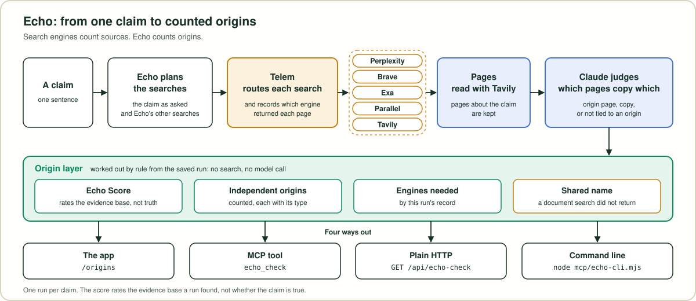

# Echo for judges

Search engines count sources. Echo counts origins. This page maps the four judging criteria to what is in the repo.

Every figure below comes from the eight runs traced live through Telem on Nov 14, saved in `mcp/traces/`. They are
recomputed offline from those files by `originFlow` and `engineScorecard` in `src/lib/echo/origin-flow.ts` and
`originLayer` in `src/lib/echo/origin-layer.ts`. To see it running with no API key, follow the tour at the top of the
[README](../README.md).

## 1. Use of Telem (40%)

**What Telem does in Echo.** Telem routed every search of the eight runs. Each search is one call with auto-routing
on, and Telem chooses among Perplexity, Brave, Exa, Parallel and Tavily. Page reading stays on Tavily.

- The Telem client: `src/lib/echo/telem.ts`. The request is sent from `src/lib/echo/pipeline.ts`, through a daily
  spending cap (`src/lib/echo/daily-budget.ts`).
- What Echo keeps from Telem's reply: which engine returned each page, which engines answered each search, and each
  engine run priced at Telem's list price. All of it is saved inside each run file in `mcp/traces/`.

**What Echo adds on top** (`src/lib/echo/origin-flow.ts`):

- Origins per engine: the origins each engine's pages lead back to.
- Engines needed: the fewest engines whose pages together reach every origin of a run, found by trying every set.
- What each search added: the engines that answered it and the pages it was first to return.

**The figures.** 8 claims, 162 engine runs billed, about $1.01 of search at list price, 145 pages kept, 28 independent
origins counted, 15 of them with only one engine on record.

**Two runs side by side.** On the phone claim every one of the five engines returned a page that leads back to the
one origin, so any one engine would have reached it (engines needed: 1 of 5). On the body-heat claim, by this run's
record, no single engine reached all 7 origins. It took 3 of the 5, and 4 origins have only one engine on record.

**Where to see it.** `/origins`: the Engines and Searches blocks on each tab, and the engine scorecard under the tabs
(`src/app/origins/page.tsx`, `src/app/origin-graphic.tsx`).

**Read the engine figures this way.** An engine is credited with a page only for the search that first returned it.
There is one run per claim. These figures describe eight runs. They do not rank the engines.

Echo's tracing works on any search. The per-engine view exists only because Telem records which engine returned each
page.

## 2. Venture potential (20%)

This part is a guess. Nobody has been asked whether they would pay for it.

- The kinds of work this check might fit are on `/origins`, each shown with a real saved run
  (`src/app/origins/use-cases.tsx`). The page says the same thing in its own words: nobody has been asked.
- The form it would most likely take is a check an agent calls before it repeats a claim. That check exists today in
  four forms (see section 4).
- The slides are at `/pitch` (`src/app/pitch/page.tsx`). Every number on them is computed from the saved runs.
- A measured comparison of prompt size with every page against origin pages only is saved for each claim in
  `src/app/origin-layer-saved.json` (one measurement each). It is shown on each tab. It is not the business case.

The next step is to ask people who do this work. That has not been done.

## 3. Innovation (20%)

- **Counting origins instead of sources.** `src/lib/echo/origin-layer.ts` turns a finished trace into an Echo Score
  (0 to 100), a count of independent origins, and a type for each origin, all by rule. The score rates the evidence
  base a run found. It does not rate whether the claim is true.
- **Engines needed.** A number a search router could take back: how many engines a claim needed, by that run's record
  (`originFlow(...).needed` in `src/lib/echo/origin-flow.ts`).
- **A name the origins share.** `src/lib/echo/upstream.ts` flags a run when most of its origins mention one name and
  no page of the run is that source. That is a sign of one outside document search did not return. It is a rule over
  the saved text, with no model call. It flags two of the eight runs: the brain claim (William James, 3 of 3
  publishers among the origins) and the habit claim (Maxwell Maltz, 3 of 4).
- **Showing the miss.** One more run from today, "95% of generative AI pilots fail", scored 98 with 8 origins counted
  from 19 pages. Most of them are separate write-ups of one report that search did not return. The run is kept in
  `evaluation/known-limits/telem-genai-pilots-2026-11-14.echo.json`, out of the tabs and out of every figure here. The
  shared-name rule now flags it (MIT, 6 of 7 publishers). The rule flags the run. It does not correct the count.

## 4. Technical execution (20%)

- **Four ways to call one check**, all answering from the same matching rule (`src/lib/echo/saved-check.ts`):
  the MCP tool `echo_check` (`mcp/echo-mcp.mjs`), plain HTTP (`src/app/api/echo-check/route.ts`), the command line
  (`mcp/echo-cli.mjs`), and a JSON-Schema tool definition (`mcp/echo-check.tool.json`). A claim with no saved run is
  refused, not guessed.
- **Pure libraries.** `origin-layer.ts`, `origin-flow.ts`, `upstream.ts`, `origin-batch.ts` and `saved-check.ts` in
  `src/lib/echo/` take a saved run and return data. They hold no network code.
- **Offline checks**, each free to run: `npm run check:origin-layer`, `npm run check:origin-flow`,
  `npm run check:upstream`, `npm run check:origin-batch`, `npm run check:copy` (no typed figures in the app's copy:
  numbers on screen are computed from the runs) and `npm run check:links` (no link can reach a route that spends).
- **Runs with no key.** `/origins` and `/pitch` read saved files when the page is built. Opening them sends no search
  and no model call.
- **Stack.** Next.js, React and TypeScript. Demo notes: `DEMO_DAY.md`.

## The eight runs

| Claim (one run each, Nov 14) | Echo Score | Pages | Origins | Engines needed |
| --- | ---: | ---: | ---: | --- |
| Americans check their phones 96 times a day | 18 | 19 | 1 | 1 of 5 |
| You lose most of your body heat through your head | 86 | 18 | 7 | 3 of 5 |
| Humans use only 10% of their brains | 10 | 20 | 3 | 2 of 4 |
| Goldfish have a 3-second memory | 6 | 18 | 2 | 1 of 5 |
| 90% of startups fail | 52 | 19 | 4 | 3 of 5 |
| It costs 5 times more to acquire a new customer than to keep an existing one | 50 | 18 | 2 | 1 of 5 |
| It takes 21 days to form a habit | 72 | 19 | 4 | 2 of 5 |
| The average human attention span is 8 seconds | 81 | 14 | 5 | 3 of 5 |

"Engines needed" is by each run's record, out of the engines whose pages Echo kept.

## What this does not show

- One run per claim. A second run of the same claim can return other pages and score differently.
- A model (Claude) judges which pages copy which. Each link is a judgment, not a measurement.
- 105 of the 145 pages could not be tied to any origin. Echo says so on every tab.
- Built before Nov 14: the tracing app, the check of pasted links, and Telem routing of the searches (committed
  Nov 13). Built on Nov 14: the origin layer, `/origins`, `/pitch`, the saved Telem runs, and the four ways to call
  the check. `git log --date=short` shows it.
